# 03 - 固件烧录与更新

固件文件在 [`BYZT-CANable2.0资料/03-固件/`](../BYZT-CANable2.0资料/03-固件/)：

| 文件 | 烧录方式 | 说明 |
|---|---|---|
| `slcan/canable2-b158aa7.bin` | ST-LINK / CubeProgrammer，地址 `0x08000000` | 串口固件，支持 CAN FD |
| `slcan/canable2-b158aa7.dfu` | DfuSe Demo / 网页 DFU | 同上，DFU 封装 |
| `candlelight/canable2_fw-ba6b1dd.bin` | ST-LINK / CubeProgrammer，地址 `0x08000000` | gs_usb 固件，不支持 FD |
| `candlelight/canable2_fw-ba6b1dd.dfu` | DfuSe Demo / 网页 DFU | 同上 |
| `candlelight/canable2-testing.bin` | 测试用 | 正常使用不需要 |

> **结论：优先用 ST-LINK 烧。** 原资料也写了“强烈建议使用这种方法”。
> USB DFU 方式对驱动/芯片状态比较敏感，容易遇到“烧一次就再也进不去 DFU”的情况。

---

## 方式一：ST-LINK（推荐，最稳）

### 接线

板上 `P4` SWD 排针：

| P4 | 信号 | ST-LINK 对应 |
|---|---|---|
| 1 | GND | GND |
| 2 | 3V3 | 3.3V（可选，板子已由 USB 供电时可不接） |
| 3 | SWDIO | SWDIO |
| 4 | SWCLK | SWCLK |

> 建议板子仍然用 Type-C 供电，ST-LINK 只接 `GND / SWDIO / SWCLK` 三根线，避免两边 3.3V 打架。

### 用 STM32CubeProgrammer

1. 打开 STM32CubeProgrammer，右上角选择 **ST-LINK**。
2. `Connect`，能读到芯片型号（STM32G431）即成功。
3. 左侧 `Erasing & Programming`：
   - File path 选 `canable2-b158aa7.bin`；
   - Start address 填 **`0x08000000`**；
   - 勾选 `Verify programming`；
   - 点 `Start Programming`。
4. 完成后断开 USB，重新上电即可。

### 用 STM32 ST-LINK Utility（老工具）

1. `Target → Connect`。
2. `Target → Program & Verify`，选择 `.bin`，地址 `0x08000000`。
3. `Start`。
4. 如果 v4.6 不认 STM32G431（太老的版本可能没有 G4 支持），改用 CubeProgrammer。

### 用命令行（可选）

```bash
STM32_Programmer_CLI -c port=SWD -w canable2-b158aa7.bin 0x08000000 -v -rst
```

---

## 方式二：网页 DFU（canable.io）

### 步骤

1. 板子断电。
2. 用镊子/跳线帽短接 **BOOT0**（P1），保持短接。
3. 插 Type-C 上电。
4. 设备管理器出现 `DFU in FS Mode`（通用串行总线设备）。
5. 首次使用先运行 `ImpulseRC_Driver_Fixer.exe` 装 DFU 驱动。
6. 打开 <https://canable.io/updater/canable2.html>。
7. 选择固件：
   - `slcan with FD support (b158aa7)`；
   - 或 `candlelight (ba6b1dd)`。
8. 点 `Connect and Update`，在弹窗里选择 `DFU in FS Mode`，连接并等待完成。
9. 断开 USB，**断开 BOOT0**，重新上电。

### 截图

网页更新流程：

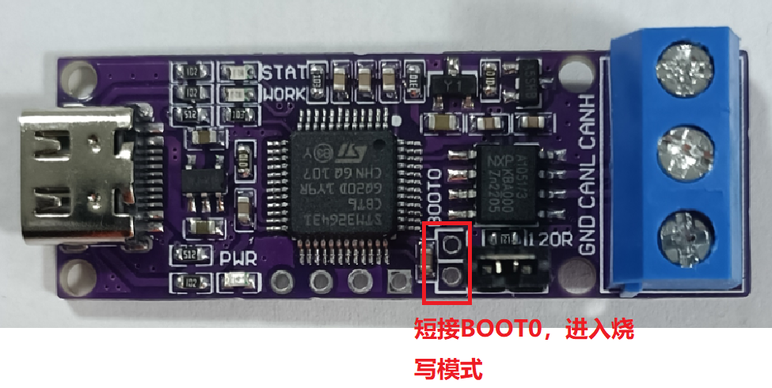
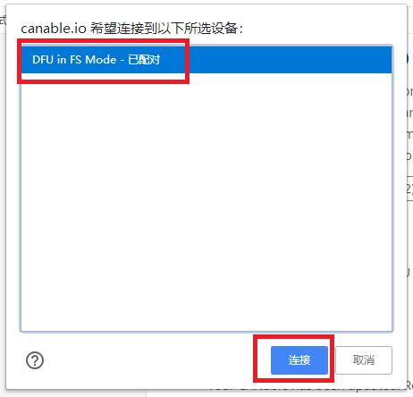
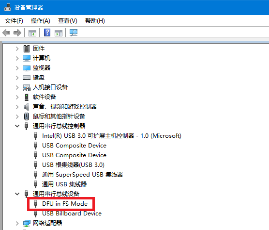
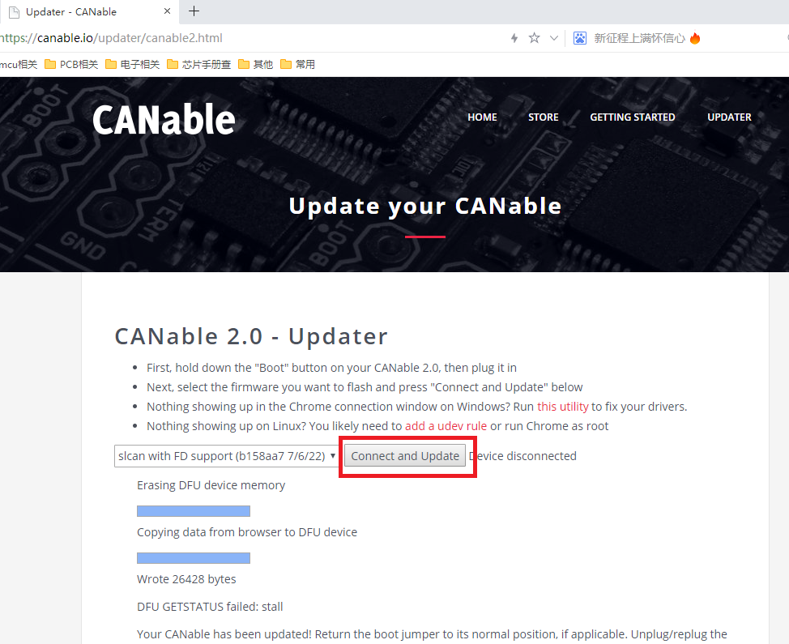

> 网页更新只认 `DFU in FS Mode`。如果设备显示为 `STM Device in DFU Mode`，说明装的是 ST 的 DfuSe 驱动，网页工具认不到，需要先在设备管理器卸载该设备，再短接 BOOT0 重新上电。

---

## 方式三：DfuSe Demo

### 安装

1. 解压 `DfuSe_Demo.rar`（资料包 `04-烧录驱动及工具`）。
2. 运行 `DfuSe_Demo_V3.0.6_Setup.exe` 安装。

### 进 DFU

1. 断电，短接 BOOT0。
2. 插 USB，设备管理器出现 `DFU in FS Mode`。
3. 右键 `DFU in FS Mode → 更新驱动程序 → 浏览计算机 → 从列表选择`。
4. 定位到 DfuSe 安装目录下的驱动，例如：

   ```text
   C:\Program Files (x86)\STMicroelectronics\Software\DfuSe v3.0.6\Bin\Driver
   ```

5. 安装完成后设备变成 `STM Device in DFU Mode`。

> 如果之前装过 `ImpulseRC_Driver_Fixer`，要先在设备管理器右键卸载 `DFU in FS Mode`，再断电/短接 BOOT0/上电，重新装 DfuSe 驱动。

### 烧录

1. 开始菜单打开 `STMicroelectronics → DfuSeDemo`。
2. 确认 `Available DFU Devices` 里能看到设备。
3. `Upgrade or Verify Action` → `Choose`，选 `.dfu` 文件：
   - `../BYZT-CANable2.0资料/03-固件/slcan/canable2-b158aa7.dfu`
   - 或 `../BYZT-CANable2.0资料/03-固件/candlelight/canable2_fw-ba6b1dd.dfu`
4. 点 `Upgrade`，弹窗选“是”。
5. 完成后断开 USB，断开 BOOT0，重新上电。

### 截图

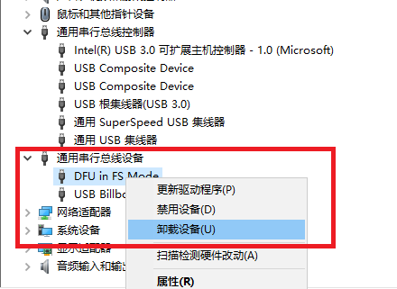
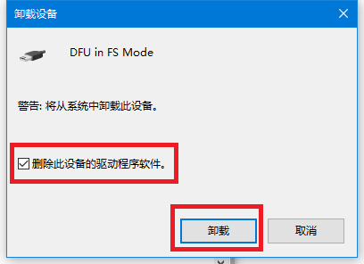
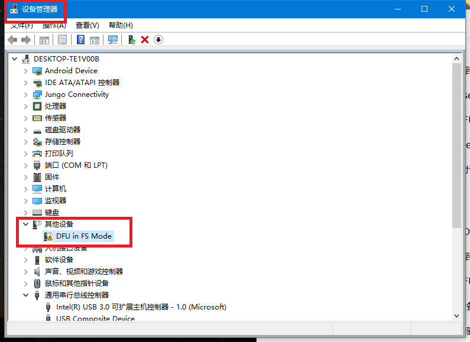
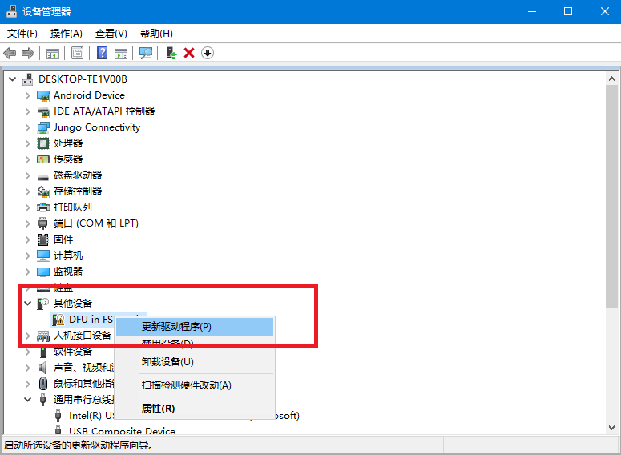
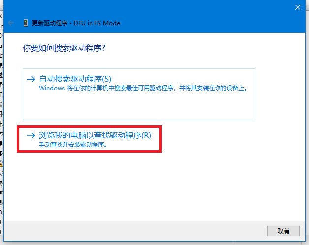
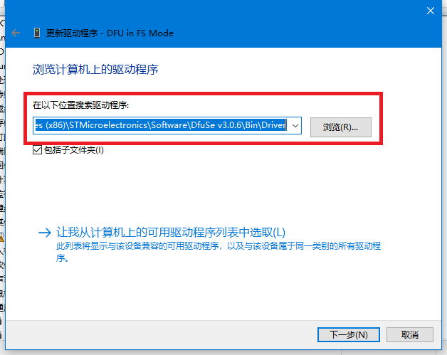
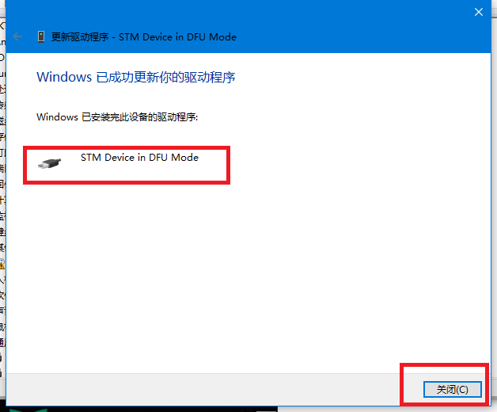
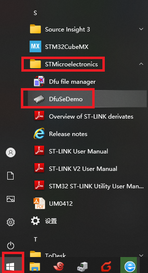
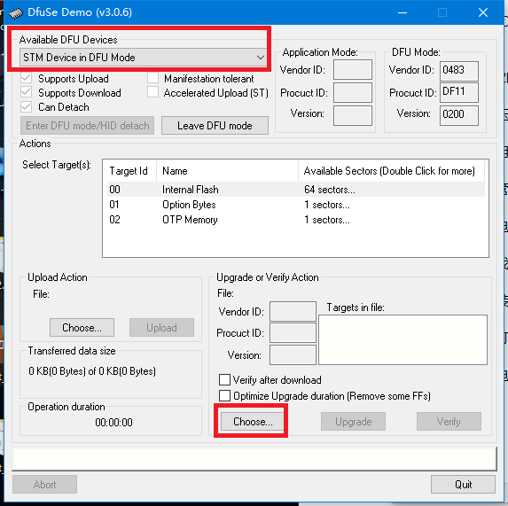
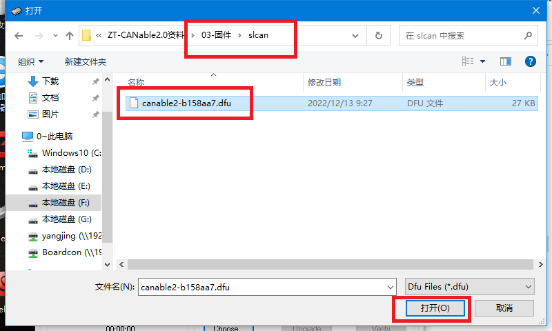
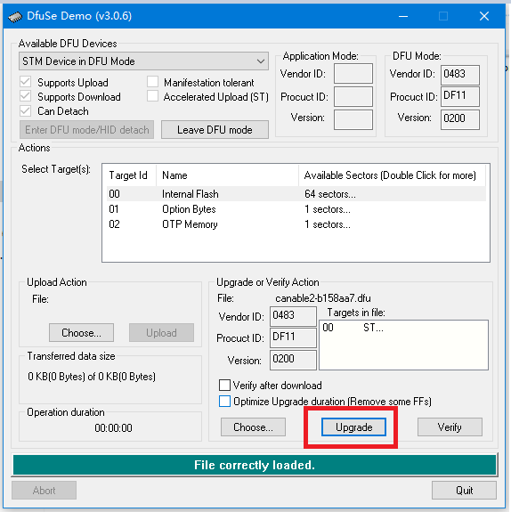
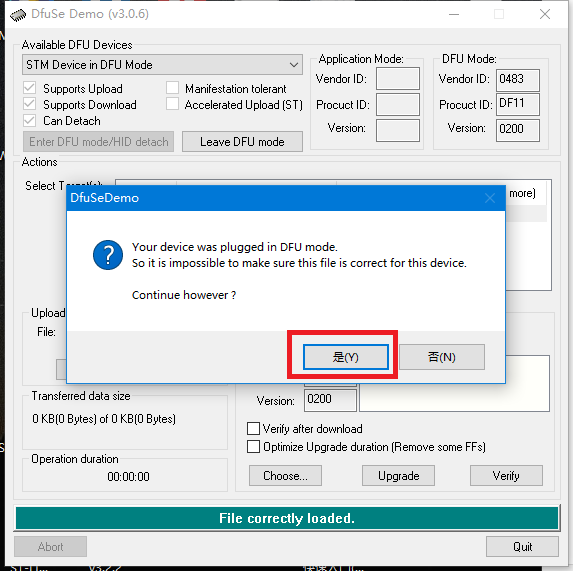
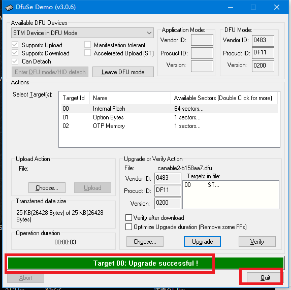

---

## 快速进入 DFU 的小技巧

已经正常使用、且装了外壳的板子：

1. 插在电脑上；
2. 拔出来；
3. **1 秒内** 再插回去。

固件会检测这个“快速重新上电”，直接进入 DFU，不需要拆壳短接 BOOT0。

正常使用时相反：**拔出后等 3 秒再插**，避免误进 DFU。

> 原理：固件把“极短时间内的重新枚举”当作升级请求。太快太慢都不行，多试几次。

---

## 烧录后检查

| 固件 | 现象 |
|---|---|
| slcan | 设备管理器出现 `USB 串行设备 (COMx)`；串口发 `V\r` 返回 `b158aa7 ...` |
| candlelight | Linux `dmesg` 出现 `gs_usb`，`ip link` 出现 `can0`；Windows 设备管理器出现 `gs_usb` 设备（需 WinUSB 驱动） |

## 变砖/无法识别怎么办

1. 断开 BOOT0，重新上电，看是否回到正常固件。
2. 短接 BOOT0 上电，看是否出现 `DFU in FS Mode`。
3. 都不行：用 ST-LINK 通过 SWD 连接，CubeProgrammer 选 `Connect under reset`，全片擦除后重新烧 `0x08000000`。
4. 检查 3.3V、晶振、SWD 接线；STM32G431 内部有 RC 时钟，固件默认可以用内部时钟，晶振不是必须。

## 固件选择提醒

- **要 CAN FD** → 只能选 `slcan`。
- **要 Linux 原生 can0 / 高吞吐** → 选 `candlelight`，但只能经典 CAN。
- 两个固件可以反复互刷，不会锁死；但每次刷完记得断开 BOOT0 再上电。
