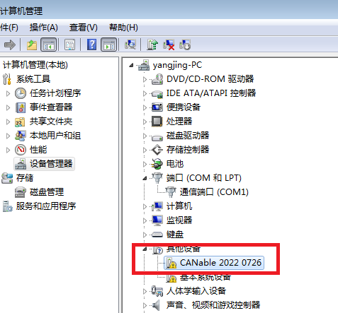
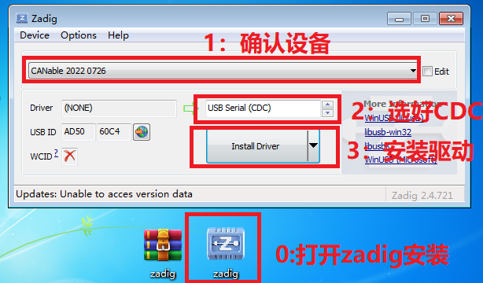
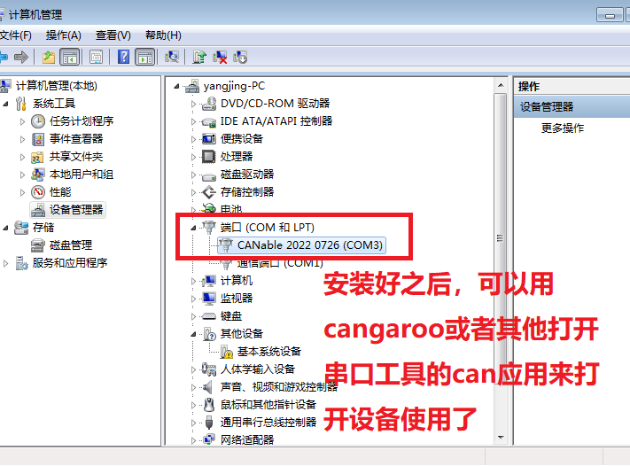
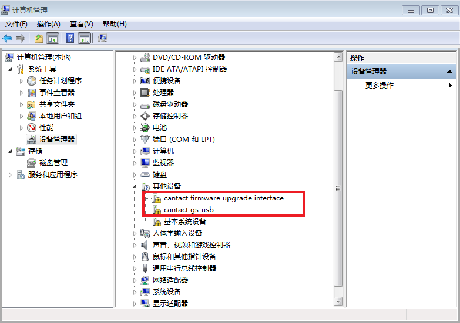
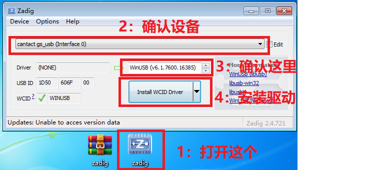
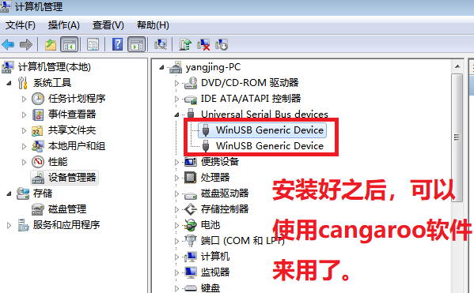

# 07 - Windows 7 下使用

Win7 不像 Win10/11 那样自带 CDC/WinUSB 驱动，需要手动装。Zadig 在 Releases：

> <https://github.com/anglersking/one_can/releases/tag/v1.0-resources>（`zadig.zip`）

## 1. slcan 固件

1. 插上板子，设备管理器里会出现一个未识别/无 COM 口的 USB 设备。
2. 解压 `zadig.zip`，运行 `zadig.exe`。
3. 菜单 `Options → List All Devices`。
4. 在下拉框里选中板子对应的设备（VID/PID 一般是 `1d50:606f` 或 `0483:5740`）。
5. 驱动目标选 **USB Serial (CDC)**。
6. 点 `Install Driver` / `Replace Driver`，等待完成。
7. 设备管理器 → 端口，出现 `USB 串行设备 (COMx)`。

截图：

> 如果 Zadig 里没有 `USB Serial (CDC)` 选项，说明版本太老，换最新版 Zadig。
> 装完后如果 COM 口仍带黄色感叹号，重启一次再试。

## 2. candleLight 固件

1. 插上板子，设备管理器出现 `gs_usb` 或未知 USB 设备。
2. 运行 Zadig，`List All Devices`，选中设备。
3. 驱动目标选 **WinUSB**。
4. `Install Driver`。
5. 之后 cangaroo / TSMaster / BUSMASTER 就能识别。

截图：

## 3. Win7 注意事项

- Win7 需要 SP1，并安装 SHA-2 补丁（KB4474419、KB4490628），否则新驱动签名验证会失败。
- Zadig 会替换设备驱动。**同一个设备不要反复在 CDC 和 WinUSB 之间来回装**，容易把注册表搞乱。
- 如果装错驱动：
  1. 设备管理器 → 右键设备 → 卸载设备；
  2. 勾选“删除此设备的驱动程序软件”；
  3. 拔插后重新用 Zadig 装正确的驱动。
- 网页 DFU 在 Win7 上还需要 `ImpulseRC_Driver_Fixer.exe` 装 DFU 驱动，见 [03-firmware-flashing.md](03-firmware-flashing.md)。
- Win7 上建议直接用 cangaroo（32 位），兼容性最好。

## 4. 升级建议

如果条件允许，建议在 Win10/11 或 Linux 上使用：

- slcan 固件免驱；
- candleLight 固件在 Win10/11 会自动装 WinUSB；
- Win7 的 USB 栈和驱动签名问题会浪费很多时间。
